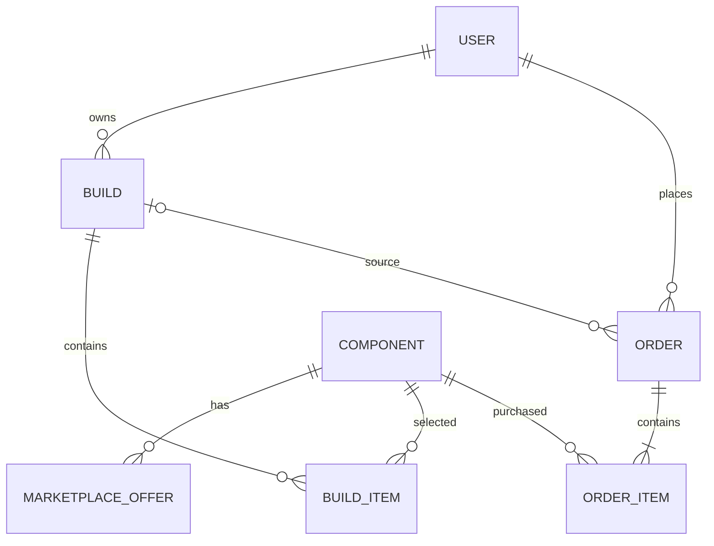

# База данных KeyCraft AI

СУБД для запуска — MySQL 8.4 (InnoDB). Миграции Laravel создают физическую схему. Семь предметных сущностей: пользователь, компонент, предложение маркетплейса, сборка, позиция сборки, заказ и позиция заказа. Служебные таблицы Laravel и Sanctum не входят в число предметных сущностей.

## Концептуальная модель



Пользователь может иметь много сборок и заказов. Состав сборки реализует связь многие ко многим между сборками и компонентами через `build_items`. Один компонент допускается в сборке одной строкой, количество хранится в этой строке. У заказа один покупатель; исходную сборку можно впоследствии удалить, история заказа сохраняется.

## Физическая модель

Все идентификаторы — `BIGINT UNSIGNED`, первичный ключ `id`. Каждая предметная таблица имеет `created_at` и `updated_at`. Денежные значения — целые числа в минимальных единицах KZT (тиын), **100 тиын = 1 тенге**. Для суммы используются `BIGINT UNSIGNED`, арифметика PHP выполняется целыми числами. Клиент отправляет и получает такие же целые значения, без округления `float`.

| Таблица | Поля, помимо id и времени | Ограничения и индексы |
| --- | --- | --- |
| `users` | `name VARCHAR(255)`, `email VARCHAR(255)`, `password VARCHAR(255)`, `role VARCHAR(20) DEFAULT buyer`; служебные поля Laravel | Уникальный email; индекс role; допустимые роли API — buyer, admin |
| `components` | `name VARCHAR(255)`, `type ENUM(case,pcb,plate,stabilizer,switch,keycap)`, `price BIGINT UNSIGNED`, `stock INT UNSIGNED DEFAULT 0`, `format VARCHAR(20) NULL`, `specs JSON` | Индексы type, format, price |
| `marketplace_offers` | `component_id`, `marketplace VARCHAR(255)`, `url VARCHAR(2048)`, `price BIGINT UNSIGNED`, `price_updated_at DATETIME` | Внешний ключ component_id; HTTPS и дата проверяются API |
| `builds` | `user_id`, `name VARCHAR(255)`, `budget BIGINT UNSIGNED` | Внешний ключ user_id |
| `build_items` | `build_id`, `component_id`, `quantity INT UNSIGNED` | Уникальная пара build_id/component_id; оба поля — внешние ключи |
| `orders` | `user_id`, `build_id NULL`, `status VARCHAR(20) DEFAULT new`, `total BIGINT UNSIGNED`, `idempotency_key VARCHAR(100)`, `request_hash CHAR(64)` | Уникальная пара user_id/idempotency_key; индекс status; внешние ключи user_id/build_id |
| `order_items` | `order_id`, `component_id`, `quantity INT UNSIGNED`, `unit_price BIGINT UNSIGNED` | Внешние ключи order_id/component_id; unit_price фиксируется при оформлении |

`quantity` проверяется как положительное целое Form Request и сервисами. Статусы заказа определяет `OrderStatus`: `new → confirmed → assembled → issued`; отменить можно `new` или `confirmed`. Роль исключена из массового заполнения User: регистрация не может назначить администратора.

## Политика удаления

| Ссылка | Действие при удалении родителя | Причина |
| --- | --- | --- |
| builds.user_id → users.id | CASCADE | Сборки принадлежат пользователю |
| orders.user_id → users.id | RESTRICT | История покупок должна сохраняться |
| build_items.build_id → builds.id | CASCADE | Позиция сборки отдельно не существует |
| build_items.component_id → components.id | RESTRICT | Используемый компонент нельзя удалить |
| marketplace_offers.component_id → components.id | RESTRICT | Предложения требуется удалить перед компонентом |
| orders.build_id → builds.id | SET NULL | Удаление сборки не удаляет заказ |
| order_items.order_id → orders.id | CASCADE | Позиция заказа отдельно не существует |
| order_items.component_id → components.id | RESTRICT | Купленный компонент нельзя удалить |

Операции заказа и отмены выполняются транзакциями. Уникальность ключа повтора обеспечивается БД отдельно для каждого покупателя. Цены в `order_items` не меняются после изменения каталога. Связанные строки остатков блокируются в согласованном порядке по ID, чтобы конкурирующие заказы не продавали один остаток дважды.

## Контракт характеристик компонентов

`format` — строковый код формата, например `65` или `75`. Для корпуса, PCB и пластины он обязателен для успешной проверки совместимости; все три должны совпадать. Отсутствующие или некорректные характеристики попадают в `unverified` и запрещают оформление.

| Тип | Обязательные характеристики `specs` | Смысл |
| --- | --- | --- |
| case | `mount: string` | Тип крепления, например gasket |
| pcb | `mount: string`, `switch_type: string`, `layout: string`, `key_count: int`, `stabilizers: object` | Тип крепления и свитчей, раскладка, число клавиш и требуемые стабилизаторы |
| plate | `mount: string`, `switch_type: string` | Совпадает с корпусом/PCB по креплению, с PCB/свитчами по типу |
| stabilizer | `stabilizers: object` | Доступное количество стабилизаторов каждого размера |
| switch | `switch_type: string`, `stem: string` | Тип свитча и посадочного креста |
| keycap | `stem: string`, `layout: string`, `key_count: int` | Крепление, поддерживаемая раскладка и покрываемое число клавиш |

Пример PCB для набора 65%:

```json
{
  "format": "65",
  "specs": {
    "mount": "gasket",
    "switch_type": "mx",
    "layout": "ansi",
    "key_count": 67,
    "stabilizers": {"2u": 3, "6.25u": 1}
  }
}
```

Сборка содержит одну позицию каждого типа. Корпус, PCB, пластина, комплект стабилизаторов и комплект кейкапов имеют количество 1; количество свитчей не меньше числа клавиш PCB. Покрытие стабилизаторов проверяется для каждого требуемого размера. Кейкапы должны совпадать по stem и layout и покрывать число клавиш.

Эта модель совместимости проверяет явно внесённые характеристики. Она не выводит совместимость из названия товара и не заменяет проверку размеров и спецификаций производителем: для учебного каталога такие детали задаются администратором в согласованных полях.

## Демонстрационные данные

Seeder создаёт два комплекта по шесть компонентов: `KeyCraft 65 ...` (67 клавиш) и `KeyCraft 75 ...` (82 клавиши). Цены и остатки демонстрационные, не являются актуальными предложениями продавца.

| Тип | Цена, тиын | Цена, тенге | Начальный остаток |
| --- | ---: | ---: | ---: |
| case | 1800000 | 18000 | 20 |
| pcb | 1400000 | 14000 | 20 |
| plate | 450000 | 4500 | 20 |
| stabilizer | 300000 | 3000 | 20 |
| switch, за штуку | 18000 | 180 | 1000 |
| keycap | 900000 | 9000 | 20 |

Стоимость набора 65% — 6056000 тиын (60560 тенге), набора 75% — 6326000 тиын (63260 тенге). Бюджет демо сборки — 10000000 тиын. Предложения AliExpress помечены «поиск» и ведут на поиск типа комплектующих, а не на подтверждённую карточку продажи. Перед использованием с настоящими товарами администратор должен заменить ссылки, цены и характеристики.

По умолчанию пользователи не создаются. Для локального показа задайте `DEMO_ADMIN_PASSWORD` и/или `DEMO_BUYER_PASSWORD` длиной от 8 символов перед `php artisan db:seed`. Будут созданы `admin@keycraft.test` и/или `buyer@keycraft.test`. Для покупателя дополнительно создаются две полные сборки. Пароли не выводятся и не сохраняются в исходном коде; хешируются моделью User. Повторный запуск seeder не перезаписывает существующие цены/остатки и пароли.

Для наполнения по КП5 отдельно запустите `php artisan db:seed --class=CourseworkSeeder` с заданным `DEMO_BUYER_PASSWORD`. Он создаёт пять покупателей (`buyer@keycraft.test`, `buyer2@keycraft.test` … `buyer5@keycraft.test`), шесть полных сборок и пять заказов с шестью позициями каждый. Если задан `DEMO_ADMIN_PASSWORD`, также создаётся администратор. Заказы проходят через настоящий `OrderService`: остатки списываются в транзакциях, один заказ отменяется с возвратом товара. Показаны все пять статусов: new, confirmed, assembled, issued, cancelled. Повторный запуск не создаёт дубликаты и не списывает остатки повторно.

Для каждой сущности создана Factory. Factory предназначены для подготовки отдельных записей в тестах и позволяют явно задавать связи/атрибуты через `state` и `for`; полную согласованную бизнес-ситуацию создаёт `CourseworkSeeder`. `UserRole` и `OrderStatus` фиксируют словари ролей и статусов в Enum. Значение User.role остаётся строкой для проверки middleware; новый пользователь получает значение buyer по умолчанию БД.

## Миграции и воспроизводимость

```text
php artisan migrate
php artisan db:seed
```

Миграция предметной схемы — `2026_11_08_000001_create_keycraft_tables.php`. Откат удаляет таблицы в обратном порядке зависимостей и поле роли. `migrate:fresh` уничтожает существующие данные и предназначен только для отдельной тестовой БД.
